# FITVANT — Home Workout Tracking & Social Accountability System

FITVANT is a full-stack web application built for my undergraduate graduation thesis. It focuses on a practical problem with working out at home: most people quit within a few weeks because static workout plans ignore their actual strength or joint pain, and training alone makes it too easy to skip a day.

Instead of asking users to log every gram of food or build their own spreadsheets, FITVANT keeps daily interaction down to simple one-tap feedback while adapting bodyweight routines behind the scenes and pairing users 1-on-1 to keep each other consistent.

---

## Tech Stack

- **Frontend:** Next.js 15 (App Router, Turbopack), React 19, TypeScript, Tailwind CSS
- **Backend:** NestJS 10, Passport JWT, Class-Validator, Swagger (OpenAPI), `@nestjs/schedule`
- **Database:** Prisma ORM (configured with SQLite out of the box for local setup; compatible with PostgreSQL)

```mermaid
flowchart LR
    subgraph Frontend["Frontend (Next.js 15)"]
        UI["Workout Player & Floating Rest Timer"]
        State["Auth, Workout & In-Memory Cache Contexts"]
    end

    subgraph Backend["Backend API (NestJS 10)"]
        Auth["Auth & Onboarding"]
        Rec["Adaptive Routine Engine"]
        Workouts["Workouts & Daily Check-in"]
        Buddy["1-on-1 Buddy & Co-op"]
        Gamify["XP, FitCoins & Midnight Cron"]
        Guard["Duration & Cap Checks"]
    end

    subgraph Database["Prisma ORM"]
        DB[("SQLite / PostgreSQL")]
    end

    UI <--> State
    State <-->|"REST + JWT"| Backend
    Backend <--> DB
```



---

## What It Does

### 1. Adaptive Routines & Injury Filtering
- **Baseline onboarding:** New users enter their height, weight, max push-up count, available household items (chair, towel, backpack, door frame, water bottles), and any active joint issues (wrist, knee, shoulder, lower back, neck, elbow).
- **Hard injury exclusions:** Exercises that stress a flagged joint are removed before a workout is assembled. For example, flagging a wrist injury automatically drops floor push-ups and burpees in favor of wrist-safe movements.
- **Cold-start & collaborative recommendations:** Early plans are generated from the user's baseline metrics and primary goal. As workout history grows, cosine similarity matches users with similar profiles to surface effective exercise variations.
- **One-tap RPE adjustment:** At the end of a workout, users rate how it felt in one tap — *Easy (1)*, *Optimal (2)*, or *Hard (3)* — which scales volume or shifts exercise difficulty up or down for the next session.

### 2. Low-Friction Workout UI
- **Built for mid-session use:** High-contrast dark olive and volt lime interface (`FITVANT` theme) with oversized buttons and Web Audio sound cues so you don't have to squint at small controls between sets.
- **Persistent rest timer:** The rest countdown uses timestamps rather than raw `setInterval` ticks, so it stays accurate across tab switches. You can minimize it into a floating bar while browsing other pages, pause/resume, or adjust rest time by `+15s` / `-15s` on the fly.
- **One-tap nutrition check-in:** Quick daily calorie balance log (*Deficit*, *Maintenance*, or *Surplus*) instead of tedious meal-by-meal tracking.
- **Bilingual interface:** Instant toggle between Vietnamese (`VI`) and English (`EN`).

### 3. 1-on-1 Buddy Accountability
- **Compatibility radar:** Suggests training partners based on similar BMI, baseline strength, and fitness goals, strictly limited to one active partner at a time so accountability stays personal.
- **Daily co-op goal:** Partners contribute reps toward a shared daily target. The shared streak only advances when *both* partners complete a workout that day.
- **Streak Freeze gifting:** Users can send a Streak Freeze from their inventory to help a partner keep their streak alive on a sick day or busy exam week.

### 4. Progression, FitCoins & Anti-Cheat Checks
- **Leveling curve:** Earned XP maps to user level via a square-root curve:

  $$\text{Level}(XP) = \left\lfloor \sqrt{\frac{XP}{100}} \right\rfloor + 1$$

  Early levels come quickly to build momentum, while higher levels require steady week-over-week consistency.
- **FitCoin loop & midnight cron:** Completing workouts and check-ins awards FitCoins, which can be spent in the shop on Streak Freezes. A scheduled job runs at `00:00` every night to evaluate streaks, consume a Streak Freeze if a day was missed, and reset daily reward counters.
- **Basic anti-cheat validation:** Every submitted session is checked against a minimum realistic duration based on total reps and rest intervals:

  $$T_{\min} = \text{TotalReps} \times 1.8\text{s} + (\text{TotalSets} - 1) \times 15\text{s}$$

  Sessions finished impossibly fast (such as clicking through a 15-minute routine in 10 seconds) are flagged and receive reduced/blocked rewards, alongside daily caps of `1500 XP` and `150 FitCoins`.

---

## Project Structure

```text
.
├── backend/                  # NestJS REST API (port 4000)
│   ├── prisma/
│   │   ├── schema.prisma     # Database models (users, exercises, logs, buddies, shop, notifications)
│   │   └── seed.ts           # Seeds 23 bodyweight exercises, shop items, and demo users
│   ├── src/
│   │   ├── auth/             # JWT authentication & bcrypt password hashing
│   │   ├── users/            # Profile & onboarding endpoints
│   │   ├── exercises/        # Exercise catalog & filtering
│   │   ├── recommendation/   # Rule-based + cosine similarity workout generator
│   │   ├── workouts/         # Session logging, today's status & 1-tap check-in
│   │   ├── gamification/     # XP/Level math, FitCoin shop & midnight streak cron
│   │   ├── buddy/            # 1-on-1 matchmaking, co-op missions & freeze gifting
│   │   ├── anti-cheat/       # Minimum duration check & daily reward caps
│   │   └── notifications/    # In-app notification center
│   └── test-e2e.ts           # Automated end-to-end verification script
│
└── frontend/                 # Next.js 15 App Router client (port 3000)
    ├── public/images/        # Local static assets for the FITVANT landing page
    └── src/
        ├── app/              # Pages: Landing/Dashboard, Login/Register, Onboarding, Workout, Buddy, Shop, Profile
        ├── components/       # Layout chrome, workout timer overlays, buddy cards & modals
        ├── context/          # Auth, Workout, Language (VI/EN) & in-memory DataCache contexts
        └── lib/              # Typed API client & catalog translations
```

---

## Getting Started Locally

### Prerequisites
- **Node.js** 18+ (tested with Node 20 / 22)
- **npm**

### 1. Set up and run the Backend
```bash
cd backend
npm install

# Create your local .env file from the template
cp .env.example .env

# Generate Prisma client, create the SQLite database, and seed sample data
npx prisma generate
npx prisma db push
npm run prisma:seed

# Start the API server in watch mode
npm run start:dev
```
- API base URL: `http://localhost:4000`
- Swagger API documentation: `http://localhost:4000/api/docs`

*(On Windows PowerShell, you can use `Copy-Item .env.example .env` instead of `cp`.)*

### 2. Set up and run the Frontend
Open a second terminal:
```bash
cd frontend
npm install

# Optional: copy .env.example if your API runs on a custom URL
cp .env.example .env

# Start the Next.js development server (with Turbopack)
npm run dev
```
- Web app: `http://localhost:3000`

### 3. Run the End-to-End Test Script
With the backend dependencies installed and database seeded:
```bash
cd backend
npx ts-node test-e2e.ts
```

---

## Demo Accounts

 After running `npm run prisma:seed`, you can sign in on the Login page with one click (or use the credentials below) to test different scenarios right away:

| Account | Email | Password | What to look for |
| :--- | :--- | :--- | :--- |
| **Minh Hoàng** | `minh.fit@example.com` | `password123` | Level 4, active 5-day streak, paired in a 1-on-1 co-op mission with Lan Phương |
| **Lan Phương** | `lan.athlete@example.com` | `password123` | Level 5, flagged **Wrist** injury — routines automatically exclude wrist-loading exercises |
| **Trần Đức Duy** | `duy.power@example.com` | `password123` | Level 3, flagged **Knee** injury — routines automatically exclude squats and high-impact jumps |
